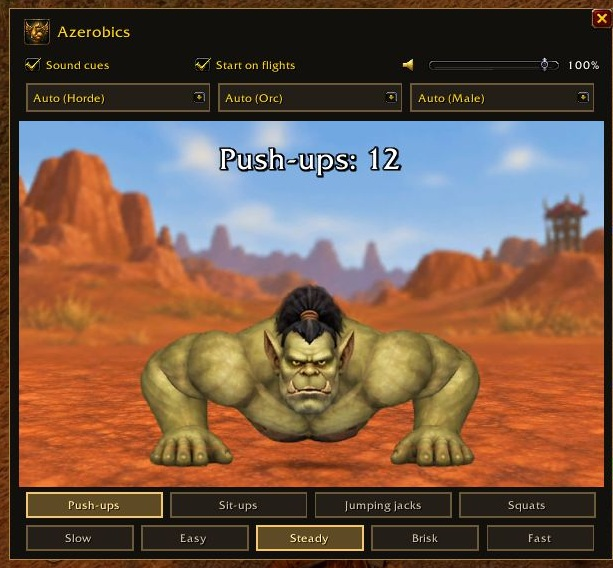

# Azerobics

Azerobics turns flight time into an exercise break in **WoW Forever**.

Follow **push-ups, sit-ups, jumping jacks, or squats** while you fly.
Auto uses your character's faction, race, and sex. You can also choose any of
the eight original races or Skyborne, male or female, with either background.

Choose your pace, set the sound cue volume, and see your totals when you land.
The summary stays open until you close it.

## Install

Copy the `Azerobics` folder into your WoW Forever `Interface/AddOns` folder.
Enable Azerobics in the game's addon list.

For WoW Forever beta 1.60.1.

## Start

The guide opens when a flight starts. Use the minimap button or `/azerobics`
to open it on the ground. Use `/azerobics a` for Alliance or `/azerobics h` for Horde.

Use the three dropdowns above the character to change the background, race,
and sex. Select an exercise below the image, then choose a pace in the bottom
row. Pace changes the pause between repetitions. Drag the title area to move
the window.

[CurseForge](https://www.curseforge.com/wow/addons/azerobics) · [Full guide](Azerobics/README.md)

## In the game

See the other views: [sit-ups](docs/screenshots/azerobics-situps.jpg), [jumping jacks](docs/screenshots/azerobics-jumping-jacks.jpg), [squats](docs/screenshots/azerobics-squats.jpg), and the [Alliance background](docs/screenshots/azerobics-alliance-jumping-jacks.jpg).
