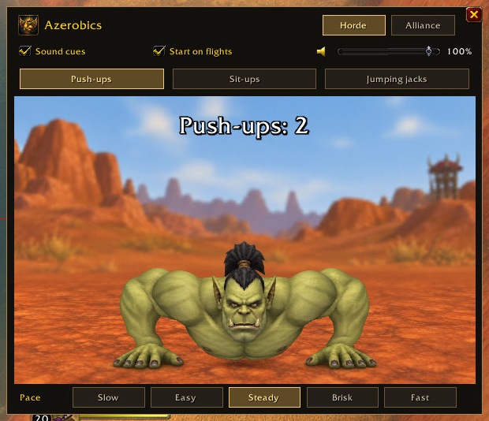
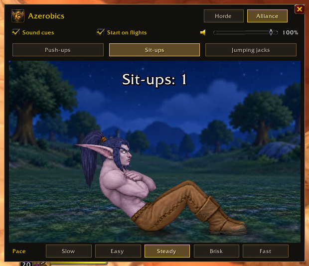
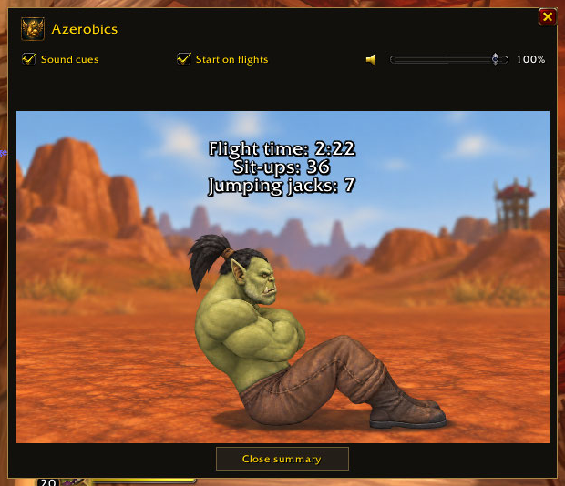

# Azerobics

A small exercise guide for World of Warcraft: Forever beta 1.60.1.

Flight paths can start a guide with push-ups, sit-ups or jumping jacks.
Choose an orc with the Horde landscape or a night elf in Elwynn Forest at night.
Each movement uses 0.75 seconds each way. Pace changes only the pause.
Sound cues, a volume slider, a minimap button and a movable window are included.
The landing summary stays open until you click a close button.

The count shows animated repetitions. It does not verify exercise.

## Use

Install the `Azerobics` folder in your game's `Interface/AddOns` folder.
Enter `/azerobics` to start, `/azerobics a` for Alliance, or `/azerobics h` for Horde.
Drag the title area to move the window.

See [the addon guide](Azerobics/README.md) for settings and commands.
Get files from [CurseForge](https://www.curseforge.com/wow/addons/azerobics).

## Screenshots

## Releases

CurseForge packages pushes to this repository through its repository webhook.
Untagged updates are alpha files. Tags with `alpha` or `beta` use that release type.
Other tags create release files. The addon version remains **1.0.0** during development.
The `.pkgmeta` file keeps development files and screenshots out of the addon ZIP.

Only runtime source, textures, sounds, release settings and public documentation belong here.
Generated source images, local checks, archives and saved game settings are excluded.
